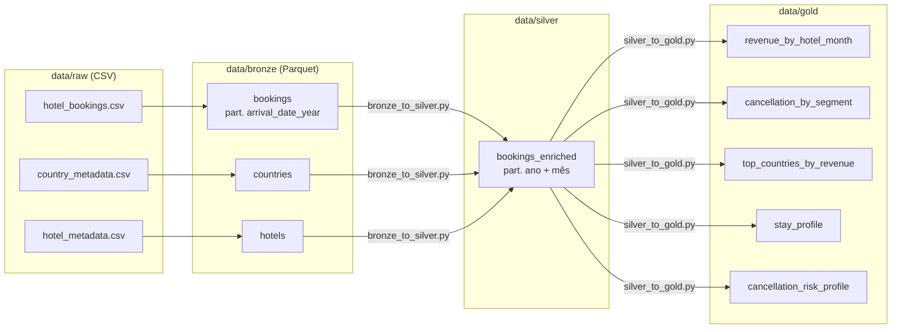

# Desafio BeFly — Pipeline Medalhão em PySpark

## 1. Visão geral

Pipeline local em PySpark (API de DataFrames) que processa o dataset público *Hotel Booking Demand* em três camadas:

- **Bronze:** cópia fiel dos 3 CSVs em Parquet Snappy, com schema explícito e metadados de ingestão.
- **Silver:** tipos corrigidos, nulos tratados, registros inválidos removidos, colunas derivadas e enriquecimento com as tabelas de referência.
- **Gold:** 5 visões agregadas para perguntas de negócio.



Estrutura:

```
scripts/      raw_to_bronze.py, bronze_to_silver.py, silver_to_gold.py
utils/        config.yaml, config.py, spark.py, schemas.py, quality_rules.py
notebooks/    exploracao_inicial.ipynb (exploração dos dados, com saídas)
tests/        testes das transformações (pytest)
data/raw/     CSVs de origem (versionados); bronze/silver/gold são gerados
```

## 2. Pré-requisitos

- Python 3.12
- Java 17 (exigido pelo PySpark 4.x)
- PySpark 4.1.3

```bash
python3 -m venv .venv
source .venv/bin/activate
pip install -r requirements.txt
```

Com o venv ativo, o `spark-submit` usado é o do pacote `pyspark` instalado no venv. Sem ativar, o comando pode cair no Python do sistema, sem o `pyspark`.

## 3. Configuração e execução

Os caminhos ficam em `utils/config.yaml`. Caminhos relativos são resolvidos a partir da raiz do repositório:

```yaml
base_path: data          # raiz das camadas
layers: {raw: raw, bronze: bronze, silver: silver, gold: gold}
raw_files:
  bookings: hotel_bookings.csv
  countries: country_metadata.csv
  hotels: hotel_metadata.csv
```

Para usar CSVs em outro local, altere `base_path`/`layers.raw` no YAML, passe outro arquivo com `--config` ou sobrescreva a raiz com `--base-path`.

Executar o pipeline, a partir da raiz do repositório:

```bash
spark-submit scripts/raw_to_bronze.py
spark-submit scripts/bronze_to_silver.py
spark-submit scripts/silver_to_gold.py
```

As escritas usam `mode("overwrite")`, então o pipeline é idempotente e pode ser reprocessado do zero.

Testes:

```bash
pytest
```

## 4. Recorte

**Dataset completo** (119.390 reservas, julho/2015 a agosto/2017), opção recomendada pelo enunciado. O volume roda em segundos no Spark local.

## 5. Achados de qualidade dos dados

Levantados no notebook `notebooks/exploracao_inicial.ipynb`; contagens abaixo são da execução do pipeline.

| Achado | Tratamento | Linhas |
|---|---|---|
| Linhas inteiramente duplicadas | **Mantidas** (ver abaixo) | 31.994 excedentes (26,8%) |
| `children = "NA"`, não coberto por `nullValue="NULL"` | Bronze lê como string; Silver usa `try_cast` e preenche com 0 | 4 |
| `country = "NULL"` | Vira `"UNK"` | 488 |
| Códigos de país legados ou ISO-2 (`CN`, `TMP`, `ANG`) | Normalizados para ISO-3 (`CHN`, `TLS`, `AGO`) | 1.279 / 3 / 0 |
| Reservas sem hóspedes (`adults + children + babies = 0`) | Removidas (`has_guests`) | 180 |
| `adr < 0` | Removida (`non_negative_adr`) | 1 |
| Países sem metadado | Apenas os `UNK`; todos os 176 códigos reais (177 na fonte, antes de unificar `CN` com `CHN`) têm correspondência | 478 após filtros |
| `adr` acima de 1.000 | Mantido; regra de alerta `adr_within_expected_range` | 1 |

**Duplicatas.** O dataset não tem ID de reserva. Sem chave de negócio, não dá para distinguir uma duplicata técnica de reservas idênticas legítimas (por exemplo, um grupo que reserva vários quartos iguais no mesmo dia pelo mesmo agente). Deduplicar removeria receita real de forma silenciosa, então as linhas foram mantidas e a contagem fica registrada aqui.

**Nomes de país ambíguos.** O `country_metadata` repete `country_name` em 6 casos. Três são aliases do mesmo país (Angola = `AGO`/`ANG`, China = `CHN`/`CN`, Timor-Leste = `TLS`/`TMP`), unificados na Silver. Os outros três são países diferentes com nome genérico: Korea (`KOR` = Coreia do Sul, `PRK` = Coreia do Norte), Congo (`COD`/`COG`) e Virgin Islands (`VGB` britânicas, `VIR` americanas). Por isso o join e os agrupamentos usam sempre o código ISO-3, nunca o nome. Ressalva: no dataset original, `CN` é ambíguo, por ser o único código ISO-2 em uma coluna ISO-3; a decisão segue o metadado fornecido, que o mapeia para China.

**Outlier de `adr`.** `adr` máximo de 5.400 em uma única reserva (p99.9 = 324; o maior valor seguinte é 510), provável erro de digitação. **Mantida**, porque o enunciado só considera inválido `adr < 0` e porque a reserva está **cancelada** (`Non Refund`, 1 noite): com `revenue = 0` e fora do `avg_adr`, não afeta nenhuma métrica de receita. O único efeito é somar 5.400 a `cancelled_potential_revenue` em `cancellation_risk_profile`, no grupo `Non Refund` / `Offline TA/TO` / `031-090` (2,8% dos € 190.128 do grupo, sem mudar sua classificação: 609 reservas, todas canceladas). A regra de alerta `adr_within_expected_range` (`adr <= 1000`) sinaliza casos como esse em cada execução.

**Outros pontos observados:** `country_metadata` tem 252 países, não ~50 como no enunciado, com chave única; `reservation_status_date` está 100% em `yyyy-MM-dd`.

**Regras de qualidade.** Ficam em `utils/quality_rules.py` como expressões SQL (`{nome: expressão}`): regras de remoção (`has_guests`, `non_negative_adr`) filtram e logam quantas linhas cada uma removeu; regras de alerta (`valid_arrival_date`, `known_country`, `has_country_metadata`, `adr_within_expected_range`) só contam e logam. O formato em SQL string permite reaproveitar as mesmas regras como expectations no Databricks.

## 6. Principais transformações da Silver

- **Bronze → Silver, tipos:** colunas inteiras com `cast("int")`, `adr` como `double`, `reservation_status_date` com `to_date(..., "yyyy-MM-dd")`. `children` usa `try_cast`, pois no Spark 4 o modo ANSI é padrão e o `cast` de `"NA"` falharia.
- **`arrival_date`:** mês por extenso mapeado para 1–12 (`arrival_date_month_num`) e data montada com `concat_ws` + `lpad` + `try_to_date`. Datas impossíveis viram nulo e são contadas pela regra `valid_arrival_date` (0 na execução).
- **Nulos:** `children` → 0, `country` → `"UNK"`.
- **Códigos de país:** aliases (`CN`, `TMP`, `ANG`) convertidos para ISO-3 antes do join, com o valor original preservado em `country_raw`. As linhas alias são removidas da dimensão, que fica com um código por país.
- **Colunas derivadas:** `total_nights`, `total_guests`, `is_family`, `is_long_stay` (`total_nights > 7`), `booking_status` (`Canceled` / `NoShow` / `CheckedOut`) e `revenue`.
- **Sinais de risco:** `lead_time_bucket` (`000-007`, `008-030`, `031-090`, `091-180`, `181-365`, `366+`), `previous_cancellations_bucket` (`0`, `1`, `2+`) e `has_previous_stay` (`previous_bookings_not_canceled > 0`). Os zeros à esquerda fazem a ordenação alfabética coincidir com a numérica.
- **`revenue = adr * total_nights` apenas quando `is_canceled = 0`**, senão 0. No dataset, No-Show sempre vem com `is_canceled = 1`, portanto conta como cancelado e não gera receita. Ver ressalva abaixo.
- **Enriquecimento:** LEFT JOIN com `country_metadata` (`country_name`, `continent`) e `hotel_metadata` (`hotel_city`, `hotel_star_rating`, `hotel_opened_year`). A contagem de linhas é verificada após cada join e o job falha com `RowCountMismatchError` se mudar (119.209 antes e depois).
- **Linhagem:** `ingested_at` (timestamp UTC da execução) e `source_file_name`, criados na Bronze, seguem para a Silver.
- **Escrita:** Parquet particionado por `arrival_date_year` e `arrival_date_month_num`.

### Ressalva: receita de No-Show e depósitos não reembolsáveis

O pipeline segue a regra do enunciado: No-Show conta como cancelado e tem `revenue = 0`. Na prática, o hotel pode cobrar o valor total da estadia ou uma multa (tipicamente a primeira diária) do No-Show, e esse valor é receita. A regra correta **depende da política comercial de cada hotel e deve ser validada com o negócio**. Ordem de grandeza nesta base:

| Cenário para os 1.206 No-Shows | Receita adicional | % da receita total (€ 25,99 mi) |
|---|---|---|
| Regra atual (sem cobrança) | € 0 | 0% |
| Cobrança da primeira diária | € 116.329 | 0,4% |
| Cobrança da estadia integral | € 449.481 | 1,7% |

A mesma questão vale para os 14.460 cancelamentos com `deposit_type = Non Refund`, em que o depósito retido também seria receita.

## 7. Visões Gold

| Visão | Granularidade | Pergunta de negócio | Métricas |
|---|---|---|---|
| `revenue_by_hotel_month` | hotel × ano × mês de chegada | Quanto cada hotel fatura mês a mês? | `total_bookings`, `effective_bookings`, `cancelled_bookings`, `total_revenue`, `avg_adr`, `total_nights_sold`, `cancellation_rate` |
| `cancellation_by_segment` | `market_segment` × `distribution_channel` × `customer_type` | Quais segmentos e canais cancelam mais? Quanto antes reservam? | `total_bookings`, `cancelled_bookings`, `cancellation_rate`, `avg_lead_time`, `avg_total_special_requests` |
| `top_countries_by_revenue` | país (Top 20) | De que países vêm os hóspedes mais valiosos? | `effective_bookings`, `total_revenue`, `avg_ticket`, `avg_lead_time`, `revenue_rank` |
| `stay_profile` | hotel × `customer_type` | Qual o perfil de estadia de cada tipo de cliente em cada hotel? | `effective_bookings`, `avg_total_nights`, `avg_total_guests`, `pct_long_stay`, `pct_family` |
| `cancellation_risk_profile` | `deposit_type` × `market_segment` × `lead_time_bucket` × `previous_cancellations_bucket` × `has_previous_stay` | Quais perfis de reserva têm alto risco de cancelamento e quanto de receita está em jogo, para direcionar campanhas de retenção? | `total_bookings`, `cancelled_bookings`, `cancellation_rate`, `cancelled_potential_revenue`, `risk_level`, `has_min_sample` |

Critérios:
- `avg_adr`, `total_nights_sold`, `top_countries_by_revenue` e `stay_profile` consideram apenas reservas efetivas (`is_canceled = 0`); reserva cancelada não gera diária nem estadia.
- `top_countries_by_revenue` exclui `UNK` do ranking, pois não é um país; empates são desfeitos pelo código do país.
- Taxas e médias são arredondadas (4 e 2 casas); cada visão é gravada em um único arquivo Parquet, já ordenado.
- `cancellation_risk_profile` é uma **5ª visão, proposta além das sugeridas**: a pergunta sobre risco de cancelamento era a única do enunciado sem visão própria. Os sinais são conhecidos no momento da reserva; `reservation_status` e `reservation_status_date` ficam de fora para evitar vazamento do desfecho.
- `cancelled_potential_revenue` (`adr * total_nights` das canceladas) mede quanto está em jogo em cada perfil e ordena a visão. `risk_level` usa limiares de 0,6 (`high`) e 0,3 (`medium`), e `has_min_sample` marca grupos com pelo menos 50 reservas, sem filtrar os menores. Limiares e volume mínimo são heurísticos e precisam ser validados com o negócio. Na execução: 221 perfis, dos quais 75 têm amostra mínima.
- Ressalvas de interpretação: (1) os sinais se misturam: 55,5% das 6.484 reservas com cancelamento anterior são `Non Refund` em `Groups` ou `Offline TA/TO`, todas canceladas, provavelmente lotes de agência cancelados em bloco; por isso a curva de `previous_cancellations` não é monotônica (94,4% com 1 cancelamento anterior, 52,7% com 2+) e a visão cruza histórico com depósito e segmento. O mesmo vale para a antecedência: dentro de `No Deposit`, a taxa sobe de 9,2% (até 7 dias) para 39,8% (181–365 dias) e cai para 20,6% acima de 1 ano. (2) O histórico é do perfil no sistema de reservas, não da pessoa: 85,7% dessas reservas têm `is_repeated_guest = 0`, e não há ID de hóspede. (3) `Non Refund` com 99,4% de cancelamento contraria a intuição de negócio; é uma anomalia conhecida do dataset, registrada e não corrigida.
- Exemplo da execução: o perfil de maior `cancelled_potential_revenue` é `No Deposit` / `Online TA` / `091-180` / sem cancelamento nem estadia anterior, com 13.052 reservas, taxa de 44,1% (`medium`) e € 3,11 mi em reservas canceladas. Dos 30 perfis `high` com amostra mínima, 18 são `Non Refund` em `Groups` ou `Offline TA/TO` e concentram 87% das reservas desse nível (13.925 de 15.974), com taxas de 92,7% a 100%.

## 8. Comentário arquitetural

Em produção, o armazenamento ficaria no S3 com layout por camada e domínio (`s3://<bucket>/{bronze,silver,gold}/<domínio>/<tabela>/`, por exemplo `silver/reservas/bookings_enriched/`) e Delta Lake no lugar de Parquet puro: transações ACID, `MERGE` para cargas incrementais e correções, time travel para auditoria e reprocessamento, e `OPTIMIZE`/`VACUUM` para compactação e limpeza. A ingestão passaria a ser incremental com Auto Loader, que detecta arquivos novos na zona de pouso e grava na Bronze com evolução de schema controlada, mantendo `ingested_at` e `source_file_name` como colunas de linhagem. A orquestração seria feita com Databricks Workflows, com deploy via Databricks Asset Bundles: a definição de jobs, clusters e permissões fica versionada como IaC declarativa nativa do Databricks, com targets `dev` e `prod` e CI/CD no GitHub Actions (testes, validação e deploy do bundle a cada merge). A qualidade usaria as expectations do Lakeflow Declarative Pipelines, reaproveitando diretamente as expressões SQL de `utils/quality_rules.py` (`expect_or_drop` para as regras de remoção e `expect` para as de alerta), com métricas de qualidade registradas a cada execução. A governança ficaria no Unity Catalog: catálogos por ambiente (`dev`, `prod`) e schemas por camada, permissões por grupo (engenharia escreve na Silver; BI só lê a Gold), linhagem de colunas automática e tabelas de referência como `country_metadata` sob controle de um dono de dados.

Uma alternativa AWS-nativa seria: S3 como data lake, Glue Data Catalog como metastore, transformações em Glue jobs (Spark) ou EMR, consulta com Athena ou Trino e orquestração com Airflow (MWAA) ou Step Functions. As tabelas poderiam usar Delta ou Iceberg sobre o Glue Catalog para manter ACID e time travel, e as regras de qualidade continuariam em SQL, avaliadas pelos próprios jobs.

Uma versão em Databricks com Asset Bundles e Lakeflow está publicada em: <!-- TODO: link da v2 -->

## 9. Limitações e próximos passos

- **Regras de receita:** No-Show e cancelamentos `Non Refund` têm receita zero por regra do enunciado (ver seção 6). Próximo passo para uma v2: uma **camada semântica** com as regras de receita por hotel (cobrança de No-Show, política de depósito, multas), para que métricas como `total_revenue` sejam definidas uma vez, com a regra de cada hotel, e consumidas de forma consistente por BI.
- **Duplicatas:** mantidas por falta de chave de negócio. Com um ID de reserva na fonte, a Silver poderia deduplicar com segurança.
- **Carga full:** cada execução reprocessa tudo com `overwrite`. Para volume real, ingestão incremental e `MERGE` (Delta).
- **Moeda:** `adr` é tratado como euro, sem conversão.
- **Outliers:** o limite de 1.000 em `adr_within_expected_range` é heurístico e global. Diárias variam por hotel, quarto e temporada; um limite por hotel e mês (por exemplo, baseado em percentis históricos) reduziria falsos alertas. Hoje a regra só alerta: com uma reserva efetiva acima do limite, a correção seria marcar a linha e excluí-la das métricas de receita, sem apagá-la.
- **Risco de cancelamento:** `cancellation_risk_profile` é descritiva: identifica **perfis** de risco e orienta regras de campanha. Atribuir um score a cada reserva exige um modelo preditivo (por exemplo, uma regressão logística sobre os mesmos sinais), avaliado com dados fora da amostra. Esse é o próximo passo.
